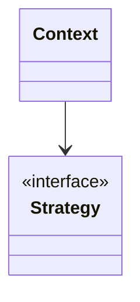

# {{PATTERN_NAME}}

> 讀書日期:
> 書中章節:

## 1. 解決什麼問題

(書中的情境,一兩句話)

## 2. 核心想法

(用自己的話,最好一句話講完)

## 3. 結構

(把上面換成這個 pattern 的實際結構,或用文字說明角色與關係)

## 4. 程式碼

- 書中範例:`src/book/`
- 自己情境改寫:`src/mine/`(情境:____)

## 5. 什麼時候不該用

(過度設計的警訊、更簡單的替代方案)

## 6. 和其他 pattern 的差異

(例如 Strategy vs State、Decorator vs Proxy)

## 7. 我的疑問 / 還沒搞懂的地方

-
