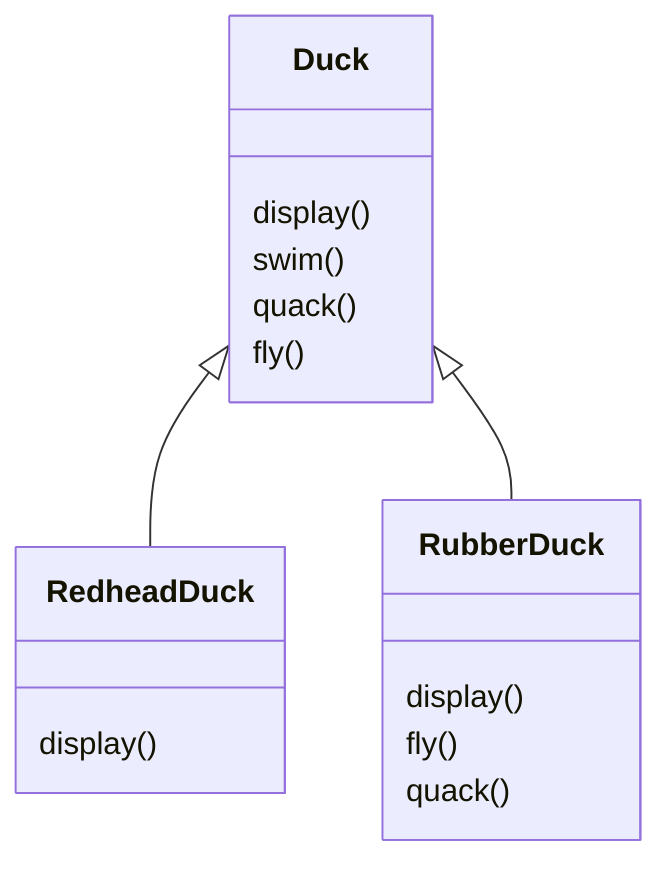
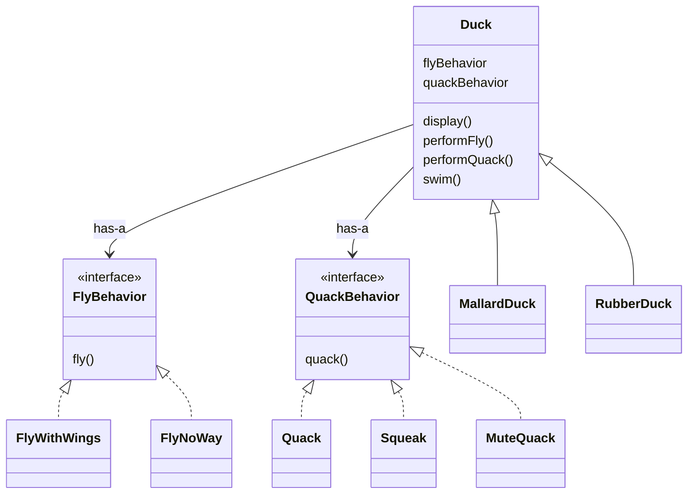

# Strategy

> 讀書日期:2026/10/18
> 書中章節:1

## 1. 解決什麼問題

**原本的設計**:模擬鴨子的遊戲,`Duck` 是父類別,有 `display()`、`swim()`、`quack()`,各種鴨子繼承它,只有 `display()` 會因鴨子不同而覆寫。

**新需求**:要讓鴨子會飛,於是在 `Duck` 加上 `fly()`。

**哪裡壞了**:橡皮鴨也繼承了 `fly()`,結果橡皮鴨滿天飛,而且橡皮鴨本來也不會呱呱叫。

(`RubberDuck` 的 `fly()` 和 `quack()` 都是為了「不要飛、不要叫」而被迫覆寫)

**想過的解法**:

- 在子類別覆寫 `fly()` / `quack()`,讓它什麼都不做
- 把 `fly()` / `quack()` 抽成 `Flyable` / `Quackable` 介面,只讓需要的鴨子實作

**缺點**:

1. 必須在子類別裡覆寫所有需要改變的方法,例如 `RubberDuck.fly()` / `quack()`
2. 無法在執行期間改變行為,因為寫死了
3. 很難知道所有鴨子的行為
4. 修改一個地方(父類),就會影響所有鴨子
5. (只用介面時)每個子類別都要自己實作,相同的程式碼無法重用

**根本原因**:「會變的行為」和「不會變的部分」綁在同一個類別裡,而繼承把行為硬塞給所有子類別,改一處就牽動全部。

## 2. 核心想法

這一章有三個設計原則:

- 找出會變的部分,把它封裝起來,和不會變的部分分開
- 針對介面(超型態)寫程式,而不是針對實作。意思是變數宣告成介面或抽象型別,實際用哪個行為物件,到執行時才決定
- 多用組合,少用繼承

Strategy 一句話:飛和叫這些行為抽成可替換的物件,`Duck` 擁有它們而不是繼承它們,所以執行期也能換。

## 3. 結構

(對照書中的圖修改)

## 4. 程式碼

- 書中範例:[src/book/](src/book/)
- 自己情境改寫:[src/mine/](src/mine/)

## 5. 什麼時候不該用

- 只有兩三種行為且幾乎不會變：一個 if/else 或 switch 就夠了
- 行為只是一小段簡單邏輯：C# 可直接傳 Func<> 或 lambda，不必為每個策略開 class
- 使用者必須懂每個策略的差異才能選：複雜度只是被轉移
- 警訊：策略 class 比實際用到的情況還多，或每個 class 只有一行程式

## 6. 和其他 pattern 的差異

(例如 Strategy vs State、Decorator vs Proxy)

## 7. 我的疑問 / 還沒搞懂的地方

- Duck clas 為什麼不該 : IFlyBehavior？
    - Duck 是「持有」行為（has-a），不是「成為」行為
- SetFlyBehavior 為什麼不用 abstract？	
    - 所有鴨子做法相同，放基底類別避免重複；要強制初始化用建構子注入
- C# 的 CS0542（成員名稱與類別同名）
    - 類別改名 QuackSound；改用建構子注入