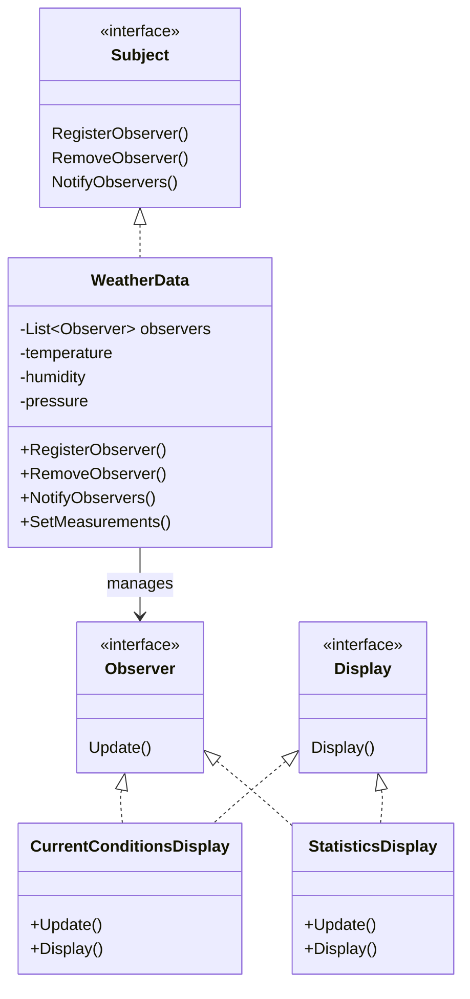

# Observer

> 讀書日期:2026/10/23
> 書中章節:2

## 1. 解決什麼問題

**情境**：氣象站 WeatherData 持續取得新的天氣資料，需要讓多個顯示面板即時更新。

例如：

- CurrentConditionsDisplay：顯示目前溫度、濕度
- StatisticsDisplay：顯示溫度統計
- ForecastDisplay：顯示天氣預報

**原本的設計**：在 WeatherData 的 `MeasurementsChanged()` 裡面，直接呼叫每個顯示面板的更新方法。

``` C#
public void MeasurementsChanged()
{
    currentDisplay.Update(temperature, humidity, pressure);
    statisticsDisplay.Update(temperature, humidity, pressure);
    forecastDisplay.Update(temperature, humidity, pressure);
}
```

**哪裡壞了**：

1. 新增一種顯示面板，就要修改 WeatherData。

2. 移除顯示面板，也要修改 WeatherData。

3. WeatherData 必須知道每一種顯示面板的具體類別。

4. 如果顯示面板的更新方式改變，可能也要修改 WeatherData。

**根本原因**：負責取得天氣資料的物件，同時負責知道有哪些面板，以及如何更新它們。

> 這讓 WeatherData 和各個顯示面板緊密耦合。

## 2. 核心想法

> 當一個物件的狀態改變時，自動通知所有已經訂閱它的觀察者。

**角色**:

- Subject：被觀察的對象，管理觀察者名單，負責註冊、移除與**主動通知**。
- Observer：觀察者，定義收到通知後要執行的更新方法。
- ConcreteSubject：實際保存狀態的物件，例如 WeatherData。
- ConcreteObserver：實際接收通知的物件，例如 CurrentConditionsDisplay。

一句話：WeatherData 不需要知道每一種顯示面板，只需要通知所有實作 Observer 的物件。

### 設計原則

- 找出程式中會改變的部分，將它們封裝起來。

- 針對介面寫程式，而不是針對具體實作。

- 努力讓互動的物件之間保持鬆散耦合。

### 一對多關係（One-to-Many）

一個 Subject 可以有多個 Observer。

```
WeatherData
    ├── CurrentConditionsDisplay
    ├── StatisticsDisplay
    └── ForecastDisplay
```

當 WeatherData 的資料更新時，所有已註冊的觀察者都會收到通知。

新增觀察者不應該要求修改 WeatherData 的通知邏輯。
## 3. 結構



注意：

WeatherData 實作 Subject，不是繼承某個具體顯示面板。

顯示面板實作 Observer，讓 WeatherData 可以用相同的方式通知不同類型的物件。

WeatherData 管理的是 Observer 介面，不是寫死每個面板的類別。

## 4. 程式碼

- 書中範例:`src/book/`
- 自己情境改寫:`src/mine/`(情境:____)

## 5. 什麼時候不該用

(過度設計的警訊、更簡單的替代方案)

- 只有一個接收者，而且不需要動態訂閱：直接呼叫方法可能更簡單
- 通知關係很固定、程式非常小：Observer 可能帶來不必要的抽象
- 需要可靠傳遞、失敗重試或嚴格的通知順序：Observer 本身不會自動提供這些能力
- 觀察者很多、更新頻繁：需要考慮效能、同步與通知成本
- 需要跨程序或跨機器通知：考慮訊息佇列或事件系統，而不只是記憶體中的物件通知

## 6. 和其他 pattern 的差異

### Observer vs Strategy

| 比較 | Observer | Strategy |
|---|---|---|
| 解決問題 | 狀態改變後通知多個對象 | 替換一種行為的實作 |
| 主要關係 | 一對多 | 一個物件持有可替換的策略 |
| 例子 | 天氣資料更新多個面板 | 鴨子切換飛行方式 |
| 核心機制 | 註冊、移除、通知 | 委派給策略物件 |

兩者都會使用介面與組合，但目的不同。

### Observer vs C# event

Observer 是一種設計模式；C# 的 `event` 是語言提供的事件機制，可以用來實作 Observer 的通知概念。

因此，使用 `event` 不代表就不再使用 Observer Pattern，而是採用另一種實作方式。

### 通知方式（Push vs. Pull）

**Push（推送）**

`Subject` 通知觀察者時，直接把資料傳過去。

```csharp
observer.Update(temperature, humidity, pressure);
````

- 好處：觀察者收到通知就有資料，不需要再向 `Subject` 索取。
- 缺點：觀察者會收到所有傳入的資料，即使它只需要其中一部分。
- 適合：通知時就已經知道觀察者需要哪些資料的情境。

** Pull（拉取）**

`Subject` 通知觀察者資料已更新，但不直接傳送資料。觀察者自行向 `Subject` 取得需要的資料。

```
observer.Update();

// 觀察者自行取得需要的資料
temperature = weatherData.Temperature;
humidity = weatherData.Humidity;
```

- 好處：觀察者可以自行決定要取得哪些資料，不必接收所有資料。
- 缺點：觀察者需要知道如何取得資料，通常也需要能存取 `Subject`。
- 適合：不同觀察者需要的資料不同，或希望由觀察者決定要讀取哪些資料的情境。

為什麼要有兩種方式？

因為 `Subject` 與 `Observer` 之間需要交換資料，但不一定要用相同的方式。

- Push：由 `Subject` 決定要傳送什麼資料。
- Pull：由 `Observer` 決定要取得什麼資料。

兩者沒有絕對的優劣，要看資料需求與耦合程度。

補充：如果使用 Push，未來資料欄位增加時，不一定要修改 `Update()` 的參數。也可以將資料封裝成一個物件，例如 `WeatherMeasurements`，再把該物件傳給觀察者。

## 7. 我的疑問 / 還沒搞懂的地方